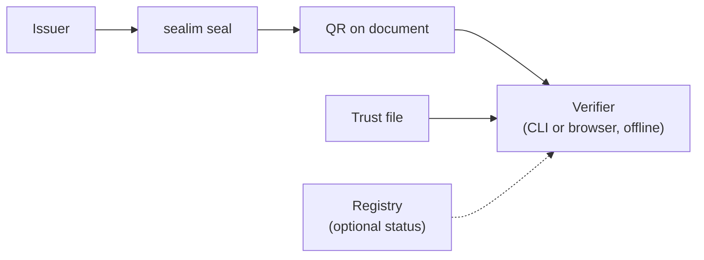
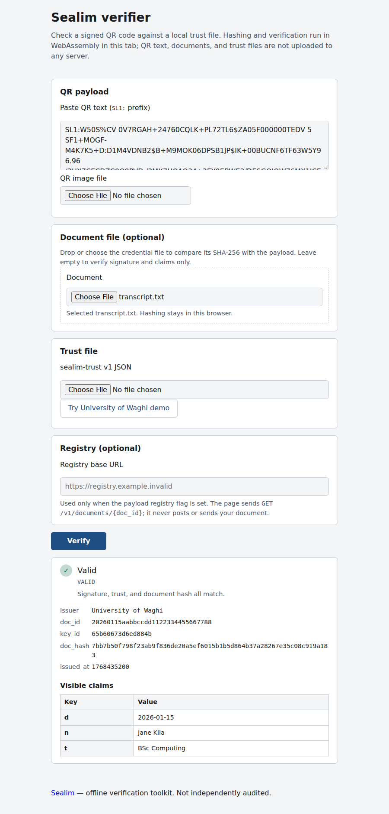

# Sealim

Seal certificates and transcripts with signed QR codes that anyone can verify offline.

[](LICENSE)
[](https://github.com/Emmanue707/sealim/actions/workflows/ci.yml)

## How it works

An issuer hashes the digital credential file, attaches optional signed **visible claims** for paper checks, and signs a compact binary payload with Ed25519. The payload is base45-encoded behind an `SL1:` prefix and printed as a QR code. A verifier decodes the QR, checks the signature against a local **trust file** of known issuer keys, optionally compares a supplied file’s SHA-256, and may query a **registry** for revocation status. Basic authenticity checks do not require live network access.



## Quick start

A hosted copy of the browser verifier runs at [https://sealim.waghitech.com](https://sealim.waghitech.com) (same static page as `web/` in this repository). Optional registry status lookups can use the public registry at [https://registry.sealim.waghitech.com](https://registry.sealim.waghitech.com) (paste the base URL on that page or open it with `?registry=https://registry.sealim.waghitech.com`).

Requires Rust (stable) and Go 1.26 or newer.

```bash
git clone https://github.com/Emmanue707/sealim.git
cd sealim
cargo test --workspace
cargo run -p sealim-cli -- --version
```

Minimal issue-and-verify flow (uses a temporary directory):

```bash
WORKDIR=$(mktemp -d)
echo 'choose-a-strong-passphrase' > "$WORKDIR/pass.txt"
cargo run -p sealim-cli -- keygen \
  --name "University of Waghi" \
  --out "$WORKDIR/issuer.key" \
  --passphrase-file "$WORKDIR/pass.txt" \
  --trust-out "$WORKDIR/trust.json"

printf '%s' 'Synthetic transcript for Jane Kila' > "$WORKDIR/document.bin"
QR=$(cargo run -p sealim-cli -- seal \
  --key "$WORKDIR/issuer.key" \
  --passphrase-file "$WORKDIR/pass.txt" \
  --file "$WORKDIR/document.bin" \
  --claim "n=Jane Kila" \
  --claim "t=BSc Computing" | tail -1)

cargo run -p sealim-cli -- verify \
  --qr "$QR" \
  --file "$WORKDIR/document.bin" \
  --trust "$WORKDIR/trust.json"
```

```bash
cd registry && go test ./...
```

Browser verifier (build WASM, then serve the repository root on loopback):

```bash
web/build.sh
python3 -m http.server 8765 --bind 127.0.0.1
```

Open `http://127.0.0.1:8765/web/`. Demo fixtures: `examples/university-of-waghi/generate.sh`.



## Usage

Subcommands: `keygen`, `seal`, `verify`, `inspect`, `register`. Global options: `--help`, `--version`.

**`sealim keygen`** — create an encrypted issuer key (`sealim-key` v1: Argon2id KDF + age ciphertext over the 32-byte Ed25519 seed; never a raw seed on disk):

```bash
sealim keygen --name "University of Waghi" \
  --out issuer.key \
  --passphrase-file pass.txt \
  --trust-out trust.json
```

**`sealim seal`** — sign a file and print `SL1:` QR text (optional PNG/SVG):

```bash
sealim seal --key issuer.key --passphrase-file pass.txt \
  --file document.bin \
  --claim "n=Jane Kila" --claim "t=BSc Computing" \
  --png qr.png
```

**`sealim verify`** — decode and verify (trust via `--trust` or `SEALIM_TRUST_FILE`):

```bash
sealim verify --qr "$QR" --file document.bin --trust trust.json
sealim verify --image scan.png --trust trust.json
sealim verify --qr "$QR" --file document.bin --trust trust.json \
  --registry http://127.0.0.1:8080
```

When the payload has the registry flag set (see `sealim seal --registry`), pass `--registry URL` or set `SEALIM_REGISTRY_URL`. If the registry cannot be reached, verification returns `STATUS_UNKNOWN` (exit 1).

**`sealim inspect`** — decode payload only (no trust file):

```bash
sealim inspect --qr "$QR"
```

**`sealim register`** — post document metadata to a registry (`POST /v1/documents`):

```bash
sealim register --key issuer.key --passphrase-file pass.txt \
  --qr "$QR" --registry http://127.0.0.1:8080
```

Exit `0` on HTTP 200/201, `1` on HTTP 409, `2` on usage, auth, or I/O errors. Requires `--registry` or `SEALIM_REGISTRY_URL`.

### Verify exit codes

| Exit | When |
|------|------|
| 0 | `VALID` or `VALID_CLAIMS_ONLY` |
| 1 | Any other verification result (`HASH_MISMATCH`, `BAD_SIGNATURE`, …) |
| 2 | Usage error, missing input, I/O, or bad trust file |

## Repository layout

| Path | Role |
|------|------|
| `crates/sealim-core` | Payload format and cryptography |
| `crates/sealim-cli` | `sealim` command |
| `crates/sealim-wasm` | WebAssembly bindings for the browser verifier |
| `web/` | Static browser verifier page |
| `examples/university-of-waghi/` | Synthetic demo transcript and trust file |
| `registry/` | Document status registry (Go) |
| `testvectors/` | Known-answer verification test cases |
| `SPEC.md` | Normative format and APIs |
| `THREAT_MODEL.md` | Threat model |
| `SECURITY.md` | Vulnerability reporting |

Known-answer test vectors are in [`testvectors/`](testvectors/).

## Registry

The Go service under `registry/` implements the document-status API from [SPEC.md](SPEC.md) section 7. It listens on loopback by default and expects TLS termination in front when exposed on a network.

A public instance is hosted at [https://registry.sealim.waghitech.com](https://registry.sealim.waghitech.com). Health check: `GET /healthz`. Document status (only when the QR payload has the registry flag set) is `GET /v1/documents/{doc_id}`. The browser verifier at [https://sealim.waghitech.com](https://sealim.waghitech.com) can call it when you enter that base URL or use `?registry=https://registry.sealim.waghitech.com`.

Run locally from `registry/` (synthetic trust file and a 64-character hex seed file required):

```bash
export SEALIM_REGISTRY_ADDR=127.0.0.1:8080
export SEALIM_DB=/tmp/sealim-registry.db
export SEALIM_TRUST_FILE=/path/to/trust.json
export SEALIM_REGISTRY_KEY=/path/to/registry.seed   # 64 hex chars, mode 0600
go run ./cmd/sealim-registry
```

The registry stores only `doc_id`, hashes, `key_id`, issue time, status, reason codes, and timestamps. It must not store credential files, names, or claims.

Build a local container image:

```bash
docker build -t sealim-registry:local registry/
```

## Roadmap

- [x] Core library: encode, sign, verify payloads
- [x] CLI: keygen, seal, verify, inspect
- [x] Registry: SQLite-backed API from `SPEC.md`
- [x] Browser verifier: WASM plus static UI

Next steps: an independent security audit, tightening the draft [SPEC.md](SPEC.md), better signed-revocation-list caching in verifiers, and more issuer-side tooling around registration and key rotation. Sealim is still experimental and **must not** be used for real credentials or legal decisions until an audit and hardening pass are done.

Normative details: [SPEC.md](SPEC.md). Contributing: [CONTRIBUTING.md](CONTRIBUTING.md).

## Security status

Sealim has **not** been independently audited. It is early-stage software and **must not** be used for real credentials or legal decisions yet. See [SECURITY.md](SECURITY.md) and [THREAT_MODEL.md](THREAT_MODEL.md).

## Licence

Apache License 2.0. See [LICENSE](LICENSE) and [NOTICE](NOTICE). Copyright Emmanuel Kokele.

## Author

Emmanuel Kokele — software engineer from Papua New Guinea, founder and lead developer of [Waghi Tech](https://waghitech.com).

- Portfolio: https://kokele.waghitech.com
- Waghi Tech: https://waghitech.com
- GitHub: [@Emmanue707](https://github.com/Emmanue707)
- Email: ekokele707@gmail.com